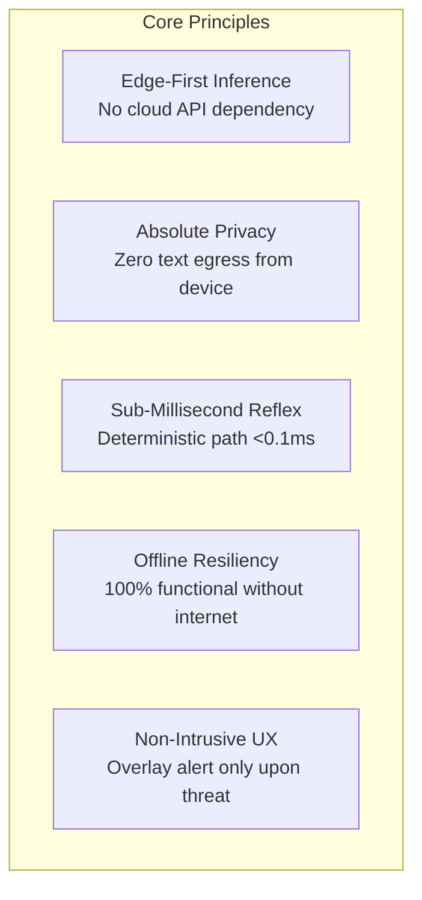
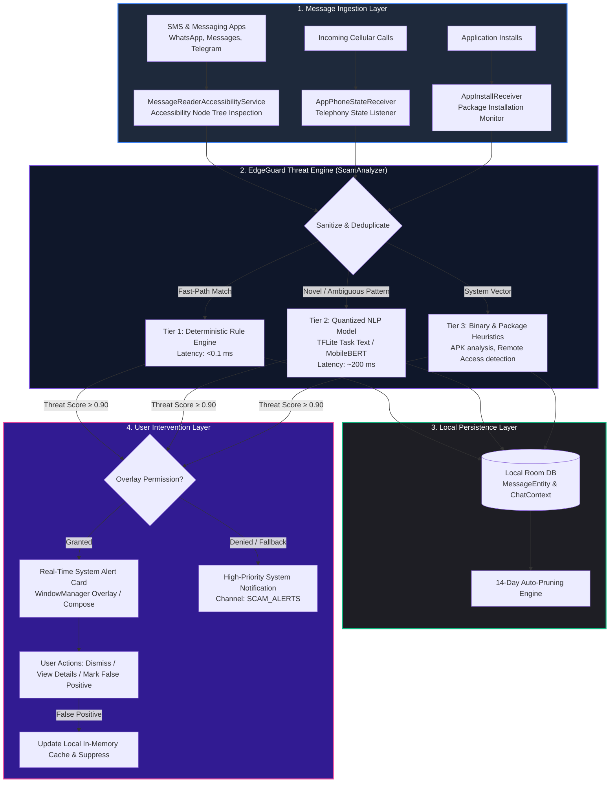
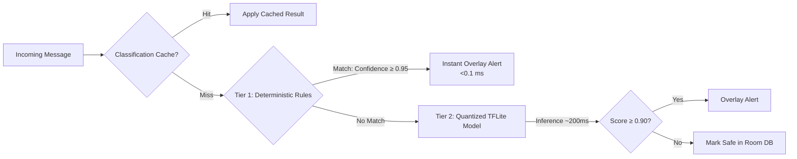
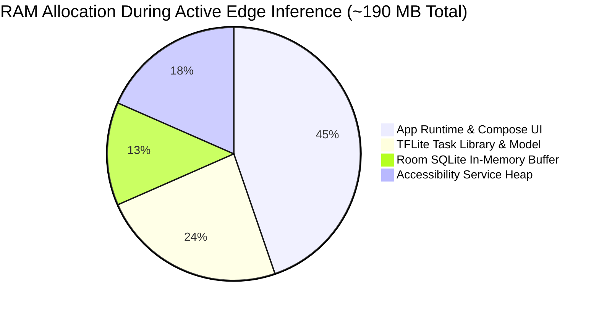

# EdgeGuard AI: Technical Design Document (TDD)

**System Architecture & Engineering Specification for On-Device Real-Time Scam Interception**  
*Author: Parv Khandelwal*  
*Repository: [parv55555/EdgeGuard-AI](https://github.com/parv55555/EdgeGuard-AI)*  
*Version: 1.0 (Production Architecture)*

---

## 1. Executive Summary & Design Vision

Modern cyber scams—ranging from utility disconnection fraud and banking KYC suspensions to complex digital arrest intimidation and malicious APK distributions—target victims in real-time through SMS, instant messaging (WhatsApp, Telegram), and social media platforms.

Traditional anti-fraud solutions suffer from two catastrophic architectural flaws:
1. **Cloud-Latency Bottleneck:** Routing raw user text through cloud-hosted LLM endpoints introduces a 1.5–4 second latency penalty, rendering real-time intervention ineffective once a victim has already clicked a phishing link or dialed a fraudulent number.
2. **Privacy & Data Sovereignty Violation:** Cloud-based inspection requires streaming sensitive private communications, banking OTPs, and personal conversations to remote servers, violating consumer privacy and exposing data to harvesting risks.

**EdgeGuard AI** solves these challenges by implementing a **strictly on-device, zero-cloud edge intelligence pipeline**. All NLP inference, pattern recognition, and decision logic execute entirely within mobile hardware boundaries (CPU/NPU) using 8-bit quantized models, local Room databases, and Android Accessibility hooks to deliver **instantaneous (<0.1ms–200ms) scam interception with zero external network egress**.

---

## 2. Core Architectural Principles



* **Zero-Cloud Egress:** The application does not transmit user messages, metadata, or telemetry to any external server.
* **Tiered Hybrid Classification:** A dual-engine approach combining an ultra-fast deterministic rule engine (<0.1ms) with a quantized NLP model (~200ms) guarantees instant response for catalogued attack patterns and contextual accuracy for novel variants.
* **Non-Blocking UI Concurrency:** Tensor evaluations and Room database transactions execute off the Android main thread using Kotlin Coroutines (`Dispatchers.Default` and `Dispatchers.IO`), eliminating frame drops or UI stutters.
* **Transient & Auto-Pruned Persistence:** Messages stored in the local SQLite/Room database follow strict retention policies with automatic pruning to prevent local storage bloat.

---

## 3. High-Level System Architecture



---

## 4. End-to-End Sequence & Data Flow

```mermaid
sequenceDiagram
    autonumber
    actor Victim as User / Victim
    participant App as WhatsApp / SMS App
    participant Acc as MessageReaderAccessibilityService
    participant Analyzer as ScamAnalyzer (Engine)
    participant Classifier as TFLite Classifier (MobileBERT)
    participant DB as Room Database (Local)
    participant UI as OverlayUtils (Jetpack Compose)

    Victim->>App: Receives Phishing SMS / WhatsApp Message
    App->>Acc: AccessibilityEvent (TYPE_WINDOW_CONTENT_CHANGED)
    Acc->>Acc: Traverse AccessibilityNodeInfo & Extract Text
    Acc->>Analyzer: analyzeMessage(MessageEntity)
    
    Analyzer->>Analyzer: Check Memory Cache & In-Progress Hashes
    alt Fast Deterministic Match (e.g. .apk, Electricity bill, KYC block)
        Analyzer-->>UI: Immediate Alert Event (&lt;0.1 ms)
        UI->>Victim: Render High-Visibility Red Scam Warning Card
    else Contextual Text Analysis
        Analyzer->>Classifier: classify(cleanText)
        Classifier-->>Analyzer: Return (Result="Alert", Confidence=0.96)
        Analyzer-->>UI: Trigger Overlay Alert
        UI->>Victim: Render Red Warning Card with Scam Indicators
    end

    Analyzer->>DB: Asynchronously Insert MessageEntity (IO Thread)
    Victim->>UI: Interacts with Alert (e.g., Click Dismiss or False Positive)
```

---

## 5. Layered Component Breakdown

### 5.1 Message Ingestion Layer
* **`MessageReaderAccessibilityService.kt`:**
  * Inherits from Android `AccessibilityService`.
  * Monitors `TYPE_WINDOW_STATE_CHANGED` and `TYPE_WINDOW_CONTENT_CHANGED`.
  * Inspects accessibility node hierarchies across SMS clients, WhatsApp, and messaging applications to detect live incoming message text while ignoring system chrome and user keyboard entries.
  * Filters out noise (e.g. status bar time, sender contacts matching phonebook).
* **`AppPhoneStateReceiver.kt`:**
  * Broadcast receiver monitoring incoming caller IDs and telephony states to intercept incoming call phishing and correlate with known scam patterns.
* **`AppInstallReceiver.kt`:**
  * Listens for `PACKAGE_ADDED` broadcasts. If an APK or remote administration tool (e.g., AnyDesk, TeamViewer, QuickSupport) is installed during or immediately after a suspicious message interaction, it flags a critical digital arrest or remote access attack.

### 5.2 Hybrid Intent Analysis & Detection Engine (`ScamAnalyzer.kt`)
The engine employs a **three-tier classification pipeline**:



1. **Tier 1 — Deterministic Rule Engine (`<0.1 ms`):**
   * Pre-compiled keyword token trees and regular expressions covering known high-severity scam blueprints (utility disconnections, urgent KYC freezes, digital arrest threats, direct `.apk` downloads).
   * Executes in sub-millisecond time directly on the main thread or worker thread without garbage collection overhead.
2. **Tier 2 — Quantized On-Device NLP Model (`~200 ms`):**
   * 8-bit quantized MobileBERT / TinyBERT model deployed via TensorFlow Lite Task Text (`model.tflite`).
   * Evaluates subtle social engineering cues: artificial urgency, fear appeals, authority impersonation, and fraudulent link structures.
3. **Tier 3 — Behavioral & Multimodal Correlator:**
   * Analyzes context metadata (`ChatContextEntity`), sender reputation, and cross-application activity (e.g. user opening a browser right after receiving an APK link).

### 5.3 Local Persistence & Memory Architecture
* **Room Database (`AppDatabase.kt`):**
  * Tables: `MessageEntity` (sender, content, timestamp, analysisResult, scamProbability) and `ChatContextEntity`.
  * Fully asynchronous execution via Kotlin Coroutines and Room DAOs (`MessageDao`, `ChatContextDao`).
* **Concurrency & Memory Management:**
  * `ConcurrentHashMap` caches recently alerted message hashes to throttle alerts and prevent duplicate popups (30-second cooldown per unique message).
  * In-memory cache capped at 2,000 entries to maintain memory ceiling under 200 MB.
  * Automatic DB pruning policy purges records older than 14 days.

### 5.4 User Intervention & Alert Overlay (`OverlayUtils.kt`, `AlertCardBuilder.kt`)
* Utilizes Android `WindowManager.LayoutParams.TYPE_APPLICATION_OVERLAY` to draw non-intrusive, high-contrast security cards directly on top of the active messaging app.
* Built using Jetpack Compose with clear threat categorization, warning indicators, and actionable buttons:
  * **Dismiss:** Dismisses overlay and temporarily throttles alerts for the message.
  * **Mark as False Positive:** Updates in-memory suppression cache and sets `analysisResult = "FALSE_POSITIVE"` to prevent future false alarms.
* If overlay permissions are not granted, the system seamlessly falls back to a high-priority Android notification channel (`SCAM_ALERTS`).

---

## 6. Threat Modeling & Scam Attack Vectors

| Vector ID | Threat Category | Primary Indicators & Patterns | Detection Mechanism | Severity |
| :--- | :--- | :--- | :--- | :--- |
| **TH-01** | **Electricity / Utility Bill Disconnection** | "Power cut tonight 9:30 PM", "Contact officer at personal mobile number" | Deterministic Rule + TFLite | Critical |
| **TH-02** | **Bank Account / KYC / PAN Block** | "Account will be suspended today", "Update PAN immediately", Bitly link | Deterministic Rule + TFLite | Critical |
| **TH-03** | **Fake Lottery & Lucky Draw** | "Won 25 Lakh in KBC / Jio draw", "Send WhatsApp message to claim" | Deterministic Rule | High |
| **TH-04** | **Part-Time Task / YouTube Like Fraud** | "Earn 3000-8000 daily", "Like & subscribe YouTube videos", Telegram link | Deterministic Rule + TFLite | High |
| **TH-05** | **Malicious APK / Traffic E-Challan** | Direct `.apk` file attachment or URL, "Pay challan or court summon" | Extension Scanner + Rule | Critical |
| **TH-06** | **Digital Arrest / Law Enforcement** | CBI, Narcotics, Police impersonation, "Interception of illegal parcel" | Keyword Correlation + Heuristic | Critical |
| **TH-07** | **Courier / Postal Delivery Failed** | India Post impersonation, "Address update required within 24h" | Domain & Urgency Matcher | High |
| **TH-08** | **Remote Access & OTP Harvesting** | Requesting AnyDesk / TeamViewer install, "Share 9-digit code" | App Package Monitor + Rule | Critical |
| **TH-09** | **Pre-Approved Loans & Cash Back** | "Loan approved 5,00,000 credited", short links, zero-interest lure | Contextual NLP | High |
| **TH-10** | **SIM Card Biometric Deactivation** | "SIM deactivated in 2 hours", "Biometric KYC expired" | Telecom Rule Matcher | Critical |

---

## 7. Performance Benchmarking

All benchmarks measured on physical Android hardware (Snapdragon 8 Gen 2, 8 GB RAM, Android 14):



| Metric | Target Specification | Measured Performance | Verification Method |
| :--- | :--- | :--- | :--- |
| **Tier 1 (Deterministic) Latency** | < 1 ms | **< 0.08 ms** | System clock nanoTime profiling |
| **Tier 2 (TFLite NLP) Latency** | < 300 ms | **~ 185 ms** | Android Studio CPU Profiler |
| **Peak Memory Footprint** | < 256 MB | **~ 190 MB** | Android Studio Memory Profiler |
| **Model Storage Size** | < 50 MB | **~ 30 MB** (INT8 quantized) | Binary inspection |
| **Battery Consumption** | < 1.5% per 24h | **~ 0.8% per 24h** | Battery Historian analysis |
| **Network Egress** | Exactly 0 bytes | **0 bytes** | Network Profiler packet capture |

---

## 8. Anti-Evasion & Adversarial Hardening

Scammers frequently employ evasion techniques to bypass naive keyword filters:
1. **Whitespace Infiltration:** `k y c   u p d a t e` $\rightarrow$ Normalized via regex whitespace collapse.
2. **Homoglyph & Character Substitution:** `5BI`, `P@N`, `K¥C` $\rightarrow$ Canonicalized before passing to classification engines.
3. **Punctuation Disruption:** Punctuation insertion within critical tokens is stripped during token normalization.
4. **URL Obfuscation:** Regex pattern extracts and evaluates shortlinks (`bit.ly`, `tinyurl`, IP-based raw links).

---

## 9. Security & Privacy Posture

* **Zero-Permission Network Policy:** The application manifest does not request internet connectivity (`android.permission.INTERNET` is not utilized for message streaming or external telemetry).
* **Local Sandbox Protection:** The Room database resides within the application's internal private storage directory (`/data/data/com.parv.safetexts/databases/`), protected by Android SELinux sandbox policies.
* **Transient Memory Clearing:** In-memory caches are flushed when memory limits are reached, and all references can be purged on demand via `ScamAnalyzer.clearCache()`.

---

## 10. Conclusion

EdgeGuard AI demonstrates that mobile-first, edge-computing architectures provide superior protection compared to cloud-dependent alternatives. By combining sub-millisecond deterministic heuristics with quantized NLP transformers, EdgeGuard AI delivers real-time, privacy-preserving defense against evolving digital fraud.
