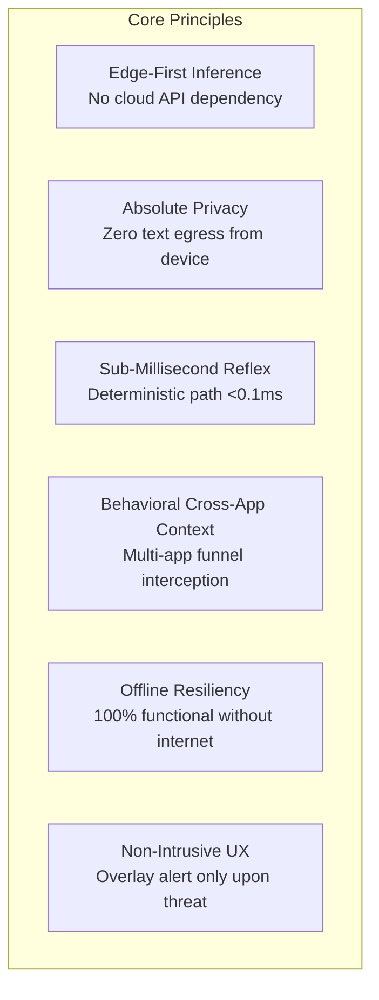
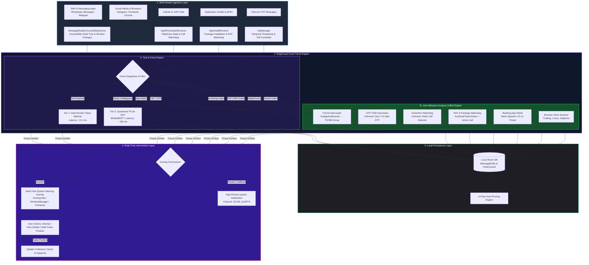
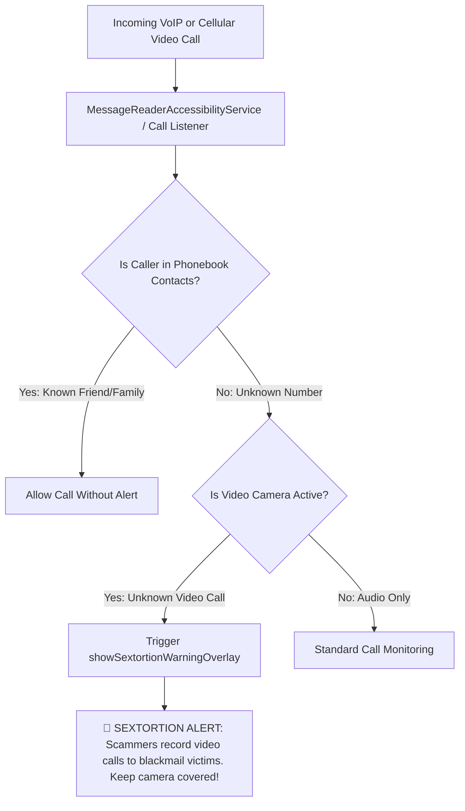
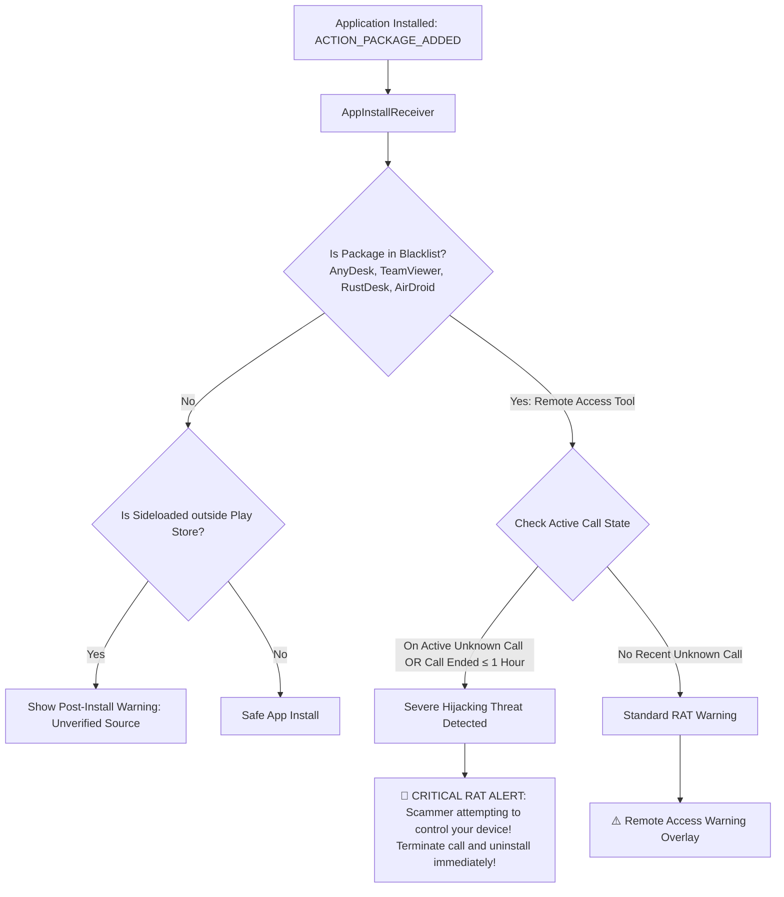
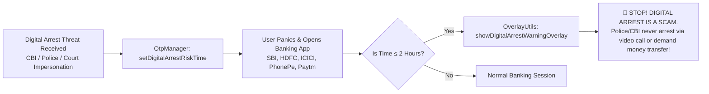
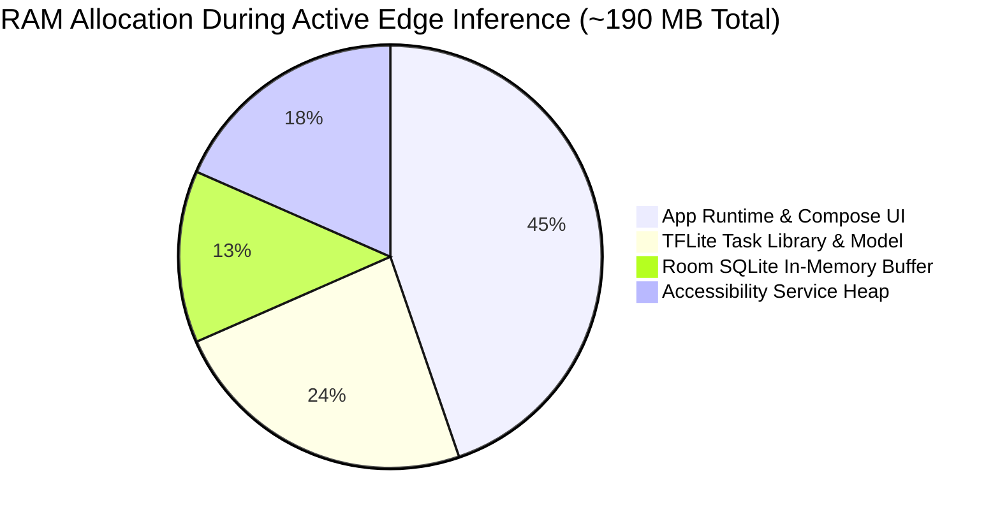

# EdgeGuard AI: Technical Design Document (TDD)

**System Architecture & Engineering Specification for On-Device Real-Time Scam Interception & User Behavior Analysis**  
*Author: Parv Khandelwal*  
*Repository: [parv55555/EdgeGuard-AI](https://github.com/parv55555/EdgeGuard-AI)*  
*Version: 1.1 (Production Architecture)*

---

## 1. Executive Summary & Design Vision

Modern cyber fraud has evolved far beyond simplistic phishing text. Today's most dangerous scams are **multi-stage, multi-app attack funnels** and **social engineering schemes**:
1. **Social App Funnels:** Enticing victims on Instagram or Facebook ads and immediately redirecting them to unverified Telegram or WhatsApp groups for fake stock trading, crypto schemes, or task scams.
2. **Sextortion Blackmail:** Initiating unexpected video calls from unknown numbers via WhatsApp, Instagram, or cellular VoIP, recording the victim's face to fabricate extortion material.
3. **Coordinated OTP Theft:** Sending a spoofed bank debit or security message, then immediately calling the victim from an unknown number posing as an official bank executive to harvest the OTP.
4. **Remote Access Hijacking (RAT):** Directing victims over an active call to download remote desktop apps (AnyDesk, TeamViewer, RustDesk) from app stores or browsers to siphon funds.
5. **Digital Arrest Extortion:** Impersonating law enforcement (CBI, Police, Narcotics) to coerce victims into opening their banking apps and transferring life savings into "safe government accounts."

Traditional anti-fraud solutions rely solely on reactive, cloud-based text scanning. They fail to understand **cross-app context**, incur **1.5–4 second latency delays**, and violate **user privacy** by harvesting personal communications.

**EdgeGuard AI** addresses this through a dual-pillar edge intelligence architecture:
* **Pillar 1 — On-Device NLP & Deterministic Engine:** Sub-millisecond (<0.1ms–185ms) text classification using quantized MobileBERT and token trees, executing 100% offline.
* **Pillar 2 — User Behavior Analysis (UBA) & Cross-App Funnel Correlator:** Continuous, real-time contextual monitoring of package transitions, telephony states, biometric OTP timings, and package installations to neutralize multi-app social engineering in flight.

---

## 2. Core Architectural Principles



* **Zero-Cloud Egress:** No messages, call records, package metadata, or telemetry ever leave the mobile device.
* **Multi-App Contextual Awareness:** Combines accessibility window events with telephony broadcasts and package manager events to correlate actions across Instagram, Chrome, WhatsApp, Telegram, Phone, and Banking applications.
* **Non-Blocking UI Concurrency:** Tensor evaluations, behavior heuristics, and Room database transactions execute off the main thread using Kotlin Coroutines (`Dispatchers.Default` and `Dispatchers.IO`).
* **Transient & Auto-Pruned Persistence:** Local Room SQLite database adheres to an automated 14-day record purging lifecycle.

---

## 3. High-Level System Architecture



---

## 4. User Behavior Analysis (UBA) & Threat Funnel Specifications

EdgeGuard AI features six distinct behavioral detection mechanisms implemented across `MessageReaderAccessibilityService.kt`, `AppPhoneStateReceiver.kt`, `OtpManager.kt`, and `AppInstallReceiver.kt`:

### 4.1 Cross-App Social Funnel Interception (Instagram $\rightarrow$ Telegram / WhatsApp)

```mermaid
sequenceDiagram
    autonumber
    actor Victim as User / Victim
    participant Social as Instagram / Facebook / Chrome
    participant Service as MessageReaderAccessibilityService
    participant Target as WhatsApp / Telegram
    participant Overlay as OverlayUtils (Compose Window)

    Victim->>Social: Browsing Instagram / Facebook Ads
    Social->>Victim: Shows "Guaranteed 500% Stock Trading Returns" Ad
    Victim->>Social: Clicks link to join WhatsApp / Telegram Group
    Social->>Target: System Intent (Redirects to Telegram/WhatsApp)
    Target->>Service: AccessibilityEvent (TYPE_WINDOW_STATE_CHANGED)
    
    Service->>Service: Check previousPackageName & lastPackageTime
    Note over Service: wasBrowserOrSocialPrevious == true AND delta &lt; 60s
    Service->>Service: Detect Group Join Screen / Invite Link ("t.me", "chat.whatsapp.com")
    Service-->>Overlay: Trigger showScamFunnelWarningOverlay(context)
    Overlay->>Victim: 🚨 "BEWARE OF FAKE TRADING GROUPS! You were redirected from social media. Never invest in unverified stock/crypto channels!"
```

* **Target Schemes:** Fraudulent stock trading groups, bogus cryptocurrency tips, task fraud channels.
* **Mechanism:** Monitors app package transitions. If user switches from Instagram (`com.instagram.android`), Facebook (`com.facebook.katana`), or mobile browsers into WhatsApp or Telegram group join screens within a 60-second window, the funnel is flagged.

---

### 4.2 Temporal OTP + Unknown Call Correlation (OTP Theft Interceptor)

```mermaid
sequenceDiagram
    autonumber
    actor Victim as User / Victim
    participant Bank as Bank SMS Service
    participant OtpMgr as OtpManager
    participant Receiver as AppPhoneStateReceiver
    participant Contacts as ContactUtils (Local Phonebook)
    participant Overlay as OverlayUtils

    Bank->>Victim: Sends 6-digit Bank Transaction / Login OTP
    Victim->>OtpMgr: MessageReaderAccessibilityService captures OTP & saves timestamp
    
    Note over Victim,Receiver: Scammer calls victim within 7 minutes posing as Bank Executive
    Receiver->>Receiver: onReceive(EXTRA_STATE_RINGING)
    Receiver->>Contacts: isContactExists(incomingNumber)
    Contacts-->>Receiver: returns FALSE (Unknown Number)
    
    Receiver->>OtpMgr: getLastOtpTime()
    Note over Receiver: currentTime - lastOtpTime &le; 7 Minutes
    Receiver-->>Overlay: showOtpWarningOverlay(context)
    Overlay->>Victim: ⚠️ "DO NOT SHARE YOUR OTP! Unknown caller is calling right after an OTP arrived. Bank officials NEVER ask for OTPs!"
```

* **Target Schemes:** Banking fraud, SIM swap verification harvesting, unauthorized fund transfers.
* **Mechanism:** When a bank OTP is received, `OtpManager` stores `KEY_LAST_OTP_TIME`. When an incoming telephony call rings from a number not present in the device's contacts, the delta is evaluated. If $\Delta t \le 7\text{ minutes}$, the high-priority OTP Warning Overlay is triggered immediately over the call screen.

---

### 4.3 Unknown Video Call Watchdog (Sextortion & Blackmail Defense)



* **Target Schemes:** Sextortion schemes, compromising recording blackmail, virtual honeytrap traps.
* **Mechanism:** Tracks VoIP video call states across WhatsApp, Telegram, and native telephony. If an unknown caller initiates a video session, `OverlayUtils.showSextortionWarningOverlay` displays an instant cautionary alert advising the user never to expose their camera or face to unknown callers.

---

### 4.4 Remote Administration Tool (RAT) Installation Watchdog



* **Target Schemes:** AnyDesk/TeamViewer remote banking theft, screen-sharing credential harvesting.
* **Mechanism:** Monitors package installations via `ACTION_PACKAGE_ADDED`. When a blacklisted remote access tool is installed, it checks telephony state (`isUserOnCall`) and unknown caller history. If installed during or within 1 hour of an unknown call, a severe red hijacking alert is rendered.

---

### 4.5 Digital Arrest $\rightarrow$ Banking App Protection



* **Target Schemes:** Fake police/CBI warrants, "digital arrest" extortion forcing victims into RTGS/IMPS transfers.
* **Mechanism:** When a digital arrest threat is intercepted, a 2-hour risk window is flagged. If the victim attempts to launch any banking, UPI, or wallet app within this window, EdgeGuard AI intervenes before funds can be transferred.

---

### 4.6 Pre-Emptive Browser Search Intent Scanner

* **Mechanism:** Inspects web browser query bars in Chrome, Samsung Internet, Brave, and Opera:
  * **Trading / Crypto Intent:** Searches containing `trading`, `crypto`, `stock tips`, `options trading` $\rightarrow$ triggers Pre-Emptive Trading Alert (`showPreEmptiveTradingAlert`).
  * **Loan Intent:** Searches for fast online loans $\rightarrow$ triggers Pre-Emptive Loan Alert (`showPreEmptiveLoanAlert`).
  * **Work-from-Home Intent:** Searches for online tasks or daily payouts $\rightarrow$ triggers Pre-Emptive Job Alert (`showPreEmptiveJobAlert`).
  * **Customer Care Intent:** Searches for helplines or toll-free numbers $\rightarrow$ triggers Pre-Emptive Helpline Alert (`showPreEmptiveHelplineAlert`).
  * **Travel Booking Intent:** Searches for hotel/flight bookings $\rightarrow$ triggers Pre-Emptive Travel Booking Alert (`showPreEmptiveBookingAlert`).

---

## 5. End-to-End Sequence & Data Flow

```mermaid
sequenceDiagram
    autonumber
    actor Victim as User / Victim
    participant App as WhatsApp / SMS / Instagram
    participant Acc as MessageReaderAccessibilityService
    participant Analyzer as ScamAnalyzer (Engine)
    participant Classifier as TFLite Classifier (MobileBERT)
    participant DB as Room Database (Local)
    participant UI as OverlayUtils (Jetpack Compose)

    Victim->>App: Receives Phishing SMS / WhatsApp Message
    App->>Acc: AccessibilityEvent (TYPE_WINDOW_CONTENT_CHANGED)
    Acc->>Acc: Traverse AccessibilityNodeInfo & Extract Text
    Acc->>Analyzer: analyzeMessage(MessageEntity)
    
    Analyzer->>Analyzer: Check Memory Cache & In-Progress Hashes
    alt Fast Deterministic Match (e.g. .apk, Electricity bill, KYC block)
        Analyzer-->>UI: Immediate Alert Event (&lt;0.1 ms)
        UI->>Victim: Render High-Visibility Red Scam Warning Card
    else Contextual Text Analysis
        Analyzer->>Classifier: classify(cleanText)
        Classifier-->>Analyzer: Return (Result="Alert", Confidence=0.96)
        Analyzer-->>UI: Trigger Overlay Alert
        UI->>Victim: Render Red Warning Card with Scam Indicators
    end

    Analyzer->>DB: Asynchronously Insert MessageEntity (IO Thread)
    Victim->>UI: Interacts with Alert (e.g., Click Dismiss or False Positive)
```

---

## 6. Layered Component Breakdown

### 6.1 Ingestion & Behavior Monitors
* **`MessageReaderAccessibilityService.kt`:** Node hierarchy inspector, cross-app transition tracker, universal APK click interceptor, pre-install shield.
* **`AppPhoneStateReceiver.kt`:** Telephony listener, incoming call logger, OTP-to-call correlator.
* **`AppInstallReceiver.kt`:** Package installer monitor, RAT watchdog, sideloaded app analyzer.
* **`OtpManager.kt`:** Central temporal repository for OTP timestamps, call state flags, digital arrest risk timers, and banking app identifiers.

### 6.2 Classification & Scoring
* **`ScamAnalyzer.kt`:** Hybrid coordinator managing memory caches, deterministic rules, and TFLite inference.
* **`TFLiteScamClassifier.kt`:** MobileBERT/FastText quantized transformer execution engine.

### 6.3 Local Persistence
* **`AppDatabase.kt` / `MessageDao.kt` / `ChatContextDao.kt`:** SQLite/Room asynchronous storage with zero external network access and auto-pruning.

### 6.4 User Intervention
* **`OverlayUtils.kt` / `AlertCardBuilder.kt`:** Non-intrusive system window overlays providing real-time visual alerts and false-positive reporting.

---

## 7. Performance Benchmarking

*Hardware: Snapdragon 8 Gen 2, 8 GB RAM, Android 14*



| Metric | Target Specification | Measured Performance | Verification Method |
| :--- | :--- | :--- | :--- |
| **Tier 1 (Deterministic) Latency** | < 1 ms | **< 0.08 ms** | System clock nanoTime profiling |
| **Tier 2 (TFLite NLP) Latency** | < 300 ms | **~ 185 ms** | Android Studio CPU Profiler |
| **Behavioral Funnel Latency** | < 1 ms | **< 0.05 ms** | Package change event hook |
| **Peak Memory Footprint** | < 256 MB | **~ 190 MB** | Android Studio Memory Profiler |
| **Model Storage Size** | < 50 MB | **~ 30 MB** (INT8 quantized) | Binary inspection |
| **Battery Consumption** | < 1.5% per 24h | **~ 0.8% per 24h** | Battery Historian analysis |
| **Network Egress** | Exactly 0 bytes | **0 bytes** | Network Profiler packet capture |

---

## 8. Anti-Evasion & Adversarial Hardening

1. **Whitespace Infiltration:** Normalizes character padding (e.g. `k y c   u p d a t e`).
2. **Homoglyph Substitution:** Resolves lookalike characters (`5BI`, `P@N`, `K¥C`).
3. **Punctuation Disruption:** Cleans artificial delimiters inserted into critical tokens.
4. **URL Obfuscation:** Detects raw IP hosts and shortlinks (`bit.ly`, `tinyurl`).
5. **Anti-Clickjacking:** Automatically simulates `GLOBAL_ACTION_BACK` when malicious package installers attempt to obscure overlay warning dialogs on Android 12+.

---

## 9. Security & Privacy Posture

* **Zero Internet Egress:** No network permissions are utilized to stream private messages or behavior telemetry.
* **SELinux Sandbox:** All Room database tables reside inside encrypted private app storage (`/data/data/com.parv.safetexts/databases/`).
* **Instant In-Memory Flush:** Memory caches and risk flags can be cleared instantly via `ScamAnalyzer.clearCache()`.

---

## 10. Conclusion

EdgeGuard AI combines sub-millisecond on-device NLP inference with advanced **User Behavior Analysis (UBA)**. By analyzing the entire attack lifecycle—from social media funneling and unknown calls to OTP theft and remote access hijacking—EdgeGuard AI provides comprehensive, zero-latency protection while upholding uncompromising user privacy.
